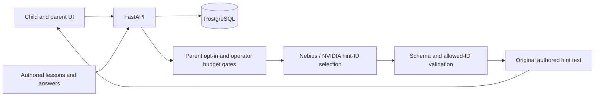

# Tarka v3 architecture

V3 directly copies V2, preserving its application structure, database approach and provider protections from Tarka's DSA core, with a separate frontend, database, cookies and ports. It has no code editor, code runner or Judge0 dependency.

## Deterministic core

The curriculum supplies each question, answer choices, answer key, explanations and allowed hints. The server grades the selected option and records attempts and assistance. The model cannot mark an answer correct, alter the curriculum or independently award progress.

The learning loop is a prepared lesson, answer attempt, bounded feedback/hint, retry, separate transfer question and persisted progress. First-attempt/no-hint/no-transfer-narration evidence is distinguished from assisted work. A small set of original questions is an MVP content library, not a complete age-specific curriculum.

## Household and child session

Setup stores a coarse age band and nickname, plus the data needed to maintain a browser household session and verify the parent gate. The session is not a verified family identity. Parent actions require the household PIN gate, ownership and request protections; a client-side hidden button alone is insufficient.

The server enforces the selected session duration (fifteen minutes by default; ten or twenty through parent settings) and the default sixty-second break. Changing a browser clock, reloading or directly calling an API must not bypass the active break. The release tests should cover those boundaries and expired parent authorization.

## Narrow optional AI

Two independent permissions are required: household AI opt-in and operator paid-operation/budget settings. Both default to off or zero. When eligible, the server sends bounded structured context and a list of authored hint identifiers.

The model response must match the expected schema and select an ID from the current question's allowed hints. Extra prose, IDs from other questions, malformed responses and provider errors must not become child-visible generated content. The server retrieves the original text for an accepted ID. A deterministic authored fallback remains available and must be labelled honestly where provider status is shown.

Only the context necessary for hint selection belongs in the provider request. The nickname, PIN, cookie tokens, raw IP address and unrelated learning history must be excluded. This is a design and test requirement; it is not a provider-retention guarantee.

## Persistence and deployment

PostgreSQL stores household/session state, answers, assistance and progress. SQLite is available for a local preview. Migrations and original content seeding make setup reproducible. V3's default ports are backend 8003 and frontend 5175.

Deploy one application process initially. Check the actual locking implementation before adding replicas or workers. Use HTTPS, secure cookies, exact permitted origins, secret injection and public-IP rate limiting before public exposure. See [DEPLOYMENT.md](DEPLOYMENT.md).

## Explicit limits

The prototype does not verify adults or legal consent, guarantee lesson suitability, diagnose learning needs, conduct open-ended child conversation, replace school instruction or provide a safeguarding service. Export and deletion cover documented application data, not independent downloaded copies, backups or provider systems. An independent review and appropriate deployment-specific checks remain necessary before use beyond an adult-led prototype trial.

## Spoken teaching path

The browser requests a named segment from `POST /api/narration` with the lesson ID. It cannot submit arbitrary speech text. FastAPI checks the owned session, age band, parent speech opt-in, current lesson state and break window, then composes only permitted authored text. It records the request before returning the transcript. The browser chooses a local English Web Speech voice, speaks only after the explicit action, and cancels speech and stale requests on context changes.

Migration 0002 adds `families.voice_enabled` (false by default) and `learning_records.narrations`. A transfer question narrated before a correct answer counts as support. Replaying post-answer feedback does not retroactively remove earned evidence. Parent exports include narration records; counts represent requests, not proof of completed playback. Existing hint, ownership and budget boundaries are unchanged.

Speech and NVIDIA inference are separate: local device speech creates no provider charge; the optional NVIDIA selector remains behind its existing opt-in and server-side cost gate. The application trusts the browser's `localService` voice metadata and does not certify underlying operating-system processing. No microphone, audio upload, audio storage or remote TTS endpoint is implemented.
