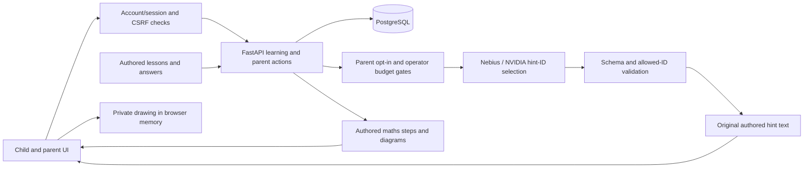

# Tarka v3 architecture

V3 directly copies V2, preserving its application structure, database approach and provider protections from Tarka's DSA core, with a separate frontend, database, cookies and ports. It has no code editor, code runner or Judge0 dependency.

## Deterministic core

The curriculum supplies each question, answer choices, answer key, explanations and allowed hints. The server grades the selected option and records attempts and assistance. The model cannot mark an answer correct, alter the curriculum or independently award progress.

The learning loop is a prepared lesson, answer attempt, bounded feedback/hint, retry, separate transfer question and persisted progress. First-attempt evidence without hints, transfer narration or whiteboard support is distinguished from assisted work. A small set of original questions is an MVP content library, not a complete age-specific curriculum.

## Accounts, sessions and the parent gate

Each parent username/password account owns one `Family` learner record. New learner setup requires authentication. Account creation stores a normalized username and a salted scrypt password verifier; it does not collect an email address. The password policy accepts 15–128 characters. Expensive hashing is bounded, and durable database rate-limit counters constrain authentication attempts. Session tokens are opaque random values, stored as keyed hashes in `auth_sessions`, with separate CSRF and parent-unlock state per session.

HttpOnly, SameSite cookies carry the token; production requires Secure cookies, HTTPS and exact permitted origins. Session identification checks expiry, revocation, family ownership and the account credential version. POST actions validate origin and session-bound CSRF. Login/registration rotate credentials; password change atomically updates the verifier/version, revokes other sessions and issues a fresh current session. Logout revokes the current session; logout-all revokes account sessions. No browser local storage holds credentials.

Default authenticated lifetimes are seven days absolute and 24 hours idle, measured by server activity. Expiry and cookie clearing require sign-in again; account-owned progress remains. Pre-account V3 cookies retain their original 30-day lifetime only while the profile is unlinked. Registration can claim such a profile with its existing PIN and invalidates the legacy bearer token. There is no self-service recovery/import after losing that legacy cookie.

Setup stores a coarse age band, nickname and separate salted parent PIN verifier. Sensitive learner controls require the short-lived PIN authorization and session ownership; account/profile deletion additionally requires the current account password and explicit confirmation. It deletes the account, sessions, learner records and family-linked usage while retaining the global spend reservation. Neither password sign-in nor adult self-attestation verifies guardianship or legal consent. No email reset, MFA or verified identity service is implemented.

The server enforces the selected session duration (fifteen minutes by default; ten or twenty through parent settings) and the default sixty-second break. Changing a browser clock, reloading or directly calling an API must not bypass the active break. The release tests should cover those boundaries and expired parent authorization.

## Narrow optional AI

Two independent permissions are required: household AI opt-in and operator paid-operation/budget settings. Both default to off or zero. When eligible, the server sends bounded structured context and a list of authored hint identifiers.

The model response must match the expected schema and select an ID from the current question's allowed hints. Extra prose, IDs from other questions, malformed responses and provider errors must not become child-visible generated content. The server retrieves the original text for an accepted ID. A deterministic authored fallback remains available and must be labelled honestly where provider status is shown.

Only the context necessary for hint selection belongs in the provider request. Account usernames/passwords, nickname, PIN, cookie tokens, raw IP address, private drawings and unrelated learning history are excluded. This is a design and test requirement; it is not a provider-retention guarantee.

## Persistence and deployment

PostgreSQL stores accounts, hashed sessions, throttle reservations, household state, answers, assistance and progress. SQLite is available for a local preview. Migrations and original content seeding make setup reproducible. Migration `0003_accounts` adds account/session/throttle tables without overwriting existing learning records; `0002_voice_teaching` remains the voice-storage predecessor. V3's default ports are backend 8003 and frontend 5175.

Deploy one application process initially. Check the actual locking implementation before adding replicas or workers. Use HTTPS, secure cookies, exact permitted origins, secret injection and public-IP rate limiting before public exposure. See [DEPLOYMENT.md](DEPLOYMENT.md).

## Explicit limits

The prototype does not verify adults or legal consent, guarantee lesson suitability, diagnose learning needs, conduct open-ended child conversation, replace school instruction or provide a safeguarding service. Export and deletion cover documented application data, not independent downloaded copies, backups or provider systems. An independent review and appropriate deployment-specific checks remain necessary before use beyond an adult-led prototype trial.

## Spoken teaching path

The browser requests a named segment from `POST /api/narration` with the lesson ID. It cannot submit arbitrary speech text. FastAPI checks the owned session, age band, parent speech opt-in, current lesson state and break window, then composes only permitted authored text. It records the request before returning the transcript. The browser chooses a local English Web Speech voice, speaks only after the explicit action, and cancels speech and stale requests on context changes.

Migration 0002 adds `families.voice_enabled` (false by default) and `learning_records.narrations`. A transfer question narrated before a correct answer counts as support. Replaying post-answer feedback does not retroactively remove earned evidence. Parent exports include narration records; counts represent requests, not proof of completed playback. Existing hint, ownership and budget boundaries are unchanged.

Speech and NVIDIA inference are separate: local device speech creates no provider charge; the optional NVIDIA selector remains behind its existing opt-in and server-side cost gate. The application trusts the browser's `localService` voice metadata and does not certify underlying operating-system processing. No microphone, audio upload, audio storage or remote TTS endpoint is implemented.

## Optional maths whiteboard

`backend/content/whiteboards.json` supplies fifteen maths worked-example boards with forty-five authored steps. The Pydantic-validated vocabulary includes text, plain equations, counters, fractions, number lines and rectangles; arbitrary executable markup is not accepted. `POST /api/whiteboard` authorizes the current owned lesson, age band, question state and break status. It returns either the authored worked example, a previously delivered hint, or checked-answer feedback.

Earlier worked examples are closed during transfer. Hint text may come from the existing NVIDIA-selected authored hint, but requesting a board itself makes no inference call and accepts no new free-form model output. Before returning content, the server records board requests and assistance within `LearningRecord.narrations`, with distinct `whiteboard_requests` and voice counts plus a shared transfer-assistance flag. These are requests for support, not observations of attention or learning gains.

The React board reveals steps on demand, renders bounded diagrams, and cancels stale requests on context changes. Its drawing pad holds bounded strokes in component memory only. It has no upload, saving, AI interpretation or automatic grading path. Learners can read the steps without using the drawing pad, and the whole board remains optional.

See [accounts and whiteboard notes](ACCOUNTS-AND-WHITEBOARD.md) and [STATUS.md](../STATUS.md) for measured verification and unresolved deployment/provider checks.
